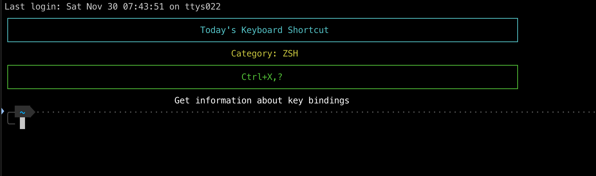

# Keyboard Shortcuts Master

[](https://github.com/jimmystridh/daily-term-shortcut/actions/workflows/release.yml)

An **awesome** interactive TUI application that helps you master keyboard shortcuts across multiple platforms and tools! Built with Rust using the `ratatui` framework.



## Features

### Interactive Learning
- **Interactive Navigation** - Browse through shortcuts with vim-style keybindings (j/k) or arrow keys
- **Daily Shortcut** - See a different shortcut each day to gradually build your muscle memory
- **Search Functionality** - Quickly find shortcuts by key combination, description, or category
- **Category Filtering** - Filter shortcuts by specific tools and platforms
- **Beautiful TUI** - Colorful, intuitive terminal interface

### Massive Shortcut Database
280+ keyboard shortcuts across **19 categories**:
- **ZSH** - Terminal shortcuts and command-line editing
- **Vim** - Modal editing, navigation, and commands
- **VS Code** - Editor shortcuts and commands
- **Git** - Version control commands
- **Browser** - Web browser navigation (Chrome, Firefox, etc.)
- **General** - Universal OS shortcuts
- **DevTools** - Browser developer tools
- **Linux** - Linux desktop environment shortcuts
- **macOS** - Mac-specific shortcuts
- **IntelliJ** - IntelliJ IDEA and JetBrains IDEs
- **Sublime** - Sublime Text editor
- **Atom** - Atom editor
- **Tmux** - Terminal multiplexer
- **Terminator** - Terminal emulator
- **Rust** - Cargo commands
- **NPM** - Node package manager commands

### Awesome Keyboard Shortcuts
**Navigation:**
- `j/k` or `↓/↑` - Move through shortcuts
- `h/l` or `←/→` - Switch between categories
- `g/G` - Jump to first/last shortcut
- `Ctrl+F/B` - Page down/up

**Features:**
- `/` - Open search mode
- `c` - Clear category filter (show all)
- `d` - Toggle daily shortcut display
- `?` - Show help screen
- `q` - Quit application

## Installation

### Pre-built binaries

Download the pre-built binary for your system from the [releases page](https://github.com/jimmystridh/daily-term-shortcut/releases). Available for:

- Linux (x86_64, ARM64) - Static binaries, no dependencies required
- Windows (x86_64, ARM64)
- macOS (Intel, Apple Silicon)

### Building from source

1. Ensure you have Rust installed on your system. If not, install it from [rustup.rs](https://rustup.rs/).

2. Clone the repository:
```bash
git clone https://github.com/jimmystridh/daily-term-shortcut
cd daily-term-shortcut
```

3. Build the project:
```bash
cargo build --release
```

4. The binary will be available in `target/release/daily-shortcut`

## Usage

Simply run the application:

```bash
./daily-shortcut
```

The application will launch an interactive TUI where you can:
- **Browse shortcuts** using j/k or arrow keys
- **Switch categories** with h/l or arrow keys
- **Search** by pressing `/` and typing your query
- **View help** by pressing `?`
- **See daily shortcut** at the top (toggle with `d`)

## Dependencies

- `ratatui` - Terminal user interface library (v0.29)
- `crossterm` - Terminal manipulation (v0.28)
- `chrono` - Date and time functionality
- `serde` & `serde_json` - Serialization
- `tui-input` - Text input handling

## Contributing

Contributions are welcome! Here are some ways you can contribute:

1. Add more shortcuts to the database
2. Add support for new categories (Emacs, Eclipse, Photoshop, etc.)
3. Improve the TUI interface
4. Add configuration file support for custom shortcuts
5. Implement favorites/bookmarking system
6. Add export functionality

Please feel free to submit issues and pull requests.

## Project Structure

```
src/
  └── main.rs    - Main application with interactive TUI
```

## What Makes This Awesome?

- **Interactive Learning**: Instead of passively reading shortcuts, actively browse and discover them
- **Comprehensive Coverage**: 280+ shortcuts across 19 different tools and platforms
- **Smart Search**: Find what you need instantly with fuzzy search across keys, descriptions, and categories
- **Category Filtering**: Focus on learning shortcuts for specific tools
- **Daily Discovery**: Learn one new shortcut each day without overwhelming yourself
- **Vim-style Navigation**: Familiar keyboard controls for efficient browsing
- **Beautiful Design**: Clean, colorful interface that's pleasant to use
- **Zero Configuration**: Works out of the box with sensible defaults
- **Blazingly Fast**: Written in Rust for instant responsiveness

## Keyboard Shortcuts in the App

The app itself uses intuitive keyboard shortcuts:

| Key | Action |
|-----|--------|
| `j` or `↓` | Next shortcut |
| `k` or `↑` | Previous shortcut |
| `h` or `←` | Previous category |
| `l` or `→` | Next category |
| `g` | Jump to first |
| `G` | Jump to last |
| `Ctrl+F` | Page down |
| `Ctrl+B` | Page up |
| `/` | Search |
| `c` | Clear filters |
| `d` | Toggle daily shortcut |
| `?` | Help screen |
| `q` | Quit |

## License

This project is licensed under the MIT License - see the LICENSE file for details.

## Acknowledgments

- Built with [ratatui](https://github.com/tui-rs-revival/ratatui)
- Inspired by the desire to master keyboard shortcuts across multiple tools
- Community contributions for shortcut database

## Roadmap

- [x] Interactive TUI with keyboard navigation
- [x] Search functionality
- [x] Category filtering
- [x] Daily shortcut display
- [x] 280+ shortcuts across 19 categories
- [ ] Configuration file support for custom shortcuts
- [ ] Favorites/bookmarking system
- [ ] Spaced repetition learning mode
- [ ] Export shortcuts to various formats (PDF, HTML, Markdown)
- [ ] Import custom shortcut files
- [ ] Quiz mode to test your knowledge
- [ ] Statistics and progress tracking

---

⭐ **Star this repository if you find it useful!** ⭐
